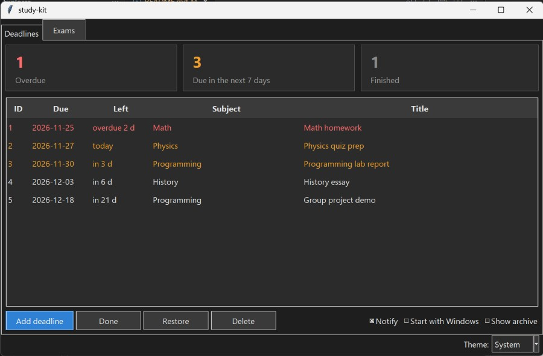
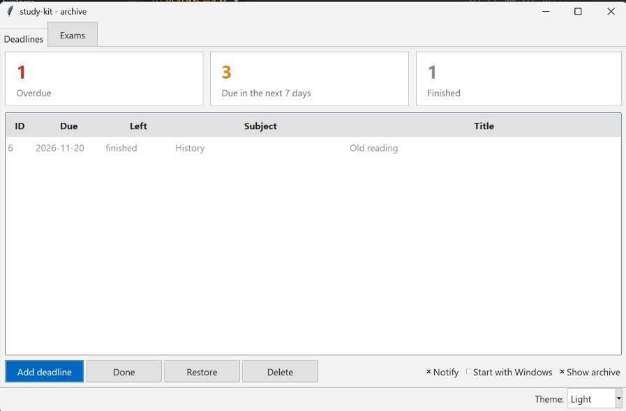
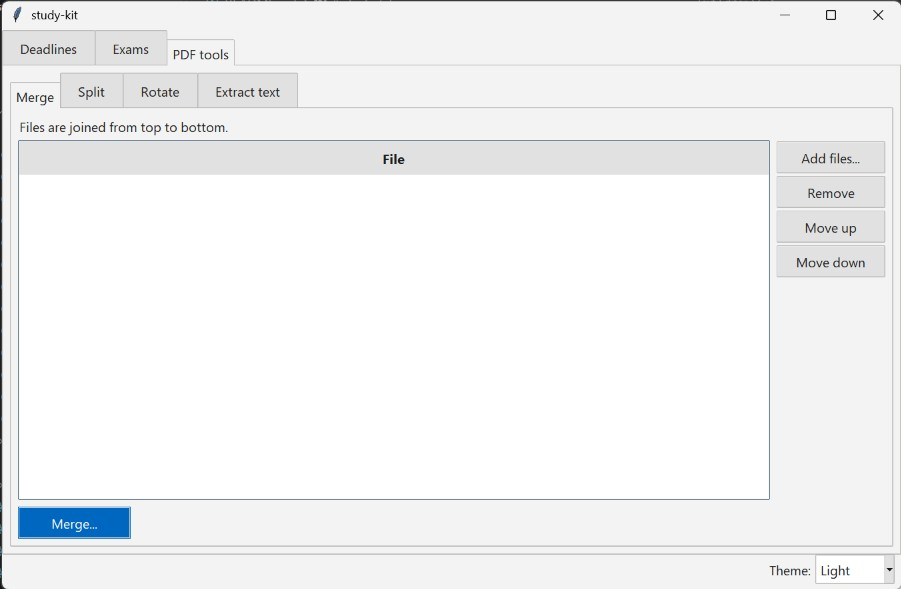

# study-kit

A small Windows app for student life: track deadlines, plan exams, and handle PDFs (merge, split, rotate, extract text). It opens as a simple window, so you can do everything with a few clicks, with no terminal needed. There is also a command-line tool for the same features.








## Features

**Deadlines**

- Add deadlines with a title, a subject, and a calendar date picker
- Subjects are remembered and offered in a dropdown
- Summary cards show how many deadlines are overdue, due in the next 7 days, and finished
- Colors show urgency: red when overdue, orange when due within 3 days
- Edit any deadline by double-clicking it
- Mark deadlines as done, then view them in the archive or restore them

**Exam planner**

- Add an exam with its date and a list of topics
- Get a day-by-day study plan that spreads the topics evenly over the days left

**PDF tools**

- **Merge** several PDFs into one, and change their order before saving
- **Split**: keep only the pages you choose, for example `1-3, 5`
- **Rotate** all pages, or only some, by 90, 180, or 270 degrees
- **Extract text** into a `.txt` file (and a warning if the PDF is a scan with no text)
- Clear error messages for missing files, bad page ranges, and password-protected PDFs

**App**

- Light, dark, or follow-the-system theme
- Sharp on high-DPI screens, and the window resizes to fit
- Daily Windows pop-up reminder for deadlines that are overdue, due today, or due tomorrow (can be turned off)
- "Start with Windows" checkbox to open the app at login

## Download (Windows)

Windows only for now. macOS support is planned.

1. Go to the [Releases page](https://github.com/Plagudoktor0/study-kit/releases) and download the latest `.zip`.
2. Unzip it and double-click `study-kit.exe`.
3. Windows may show **"Windows protected your PC"**. Click **More info**, then **Run anyway**. This happens because the app isn't code-signed. The full source code is in this repository.

Your data is stored only on your computer, in `C:\Users\<your name>\.studykit\data.json`. PDF files are never uploaded anywhere. Everything runs locally.

**To uninstall:** untick **Start with Windows** in the app, then delete `study-kit.exe` and the `.studykit` folder.

## Run from source

Requires Python 3.10 or newer.

```
git clone https://github.com/Plagudoktor0/study-kit.git
cd study-kit
python -m venv .venv
.venv\Scripts\activate
pip install -e .
python -m studykit.gui
```

## Command-line tool

Deadlines:

```
studykit add "OS assignment" --due 2026-12-01 --subject OS
studykit list
studykit list --all
studykit next
studykit done 1
studykit restore 1
studykit delete 1
```

Exams:

```
studykit exam add "Networks" --date 2026-12-10 --topics "TCP, UDP, DNS, HTTP"
studykit exam list
studykit exam plan 1
studykit exam delete 1
```

PDF tools:

```
studykit pdf merge a.pdf b.pdf -o merged.pdf
studykit pdf split merged.pdf --pages "1-3, 5" -o part.pdf
studykit pdf rotate part.pdf --angle 90 --pages "1"
studykit pdf text part.pdf -o part.txt
```

Run `studykit --help` or `studykit pdf --help` to see every option.

## Project structure

```
src/studykit/
  gui.py         window, tabs, and dialogs
  pdf_panel.py   the PDF tools tab
  pdf_tools.py   PDF logic: merge, split, rotate, extract text
  deadlines.py   deadline logic: add, edit, done, archive, summary
  exams.py       exam logic and the study-plan algorithm
  subjects.py    saved subjects
  reminders.py   which deadlines need a reminder (once per day)
  notifier.py    Windows pop-up notification
  autostart.py   "Start with Windows" setting
  theme.py       light/dark themes and high-DPI scaling
  storage.py     JSON data file
  cli.py         command-line tool
tests/           pytest tests for the logic and the command line
```

## Tests

```
pip install pytest
pytest
```

## Build the exe

Run these inside the activated virtual environment:

```
pip install -e .
pip install pyinstaller
pyinstaller --onefile --windowed --name study-kit --paths src --hidden-import babel.numbers --hidden-import winotify launcher.py
```

The exe appears in the `dist` folder. The two `--hidden-import` options are needed because the calendar and notification libraries load some modules in a way PyInstaller can't detect.

## Roadmap

- [x] Edit a deadline by double-clicking it
- [x] Windows notifications for deadlines that are due soon
- [x] Exam planner
- [x] Dark mode
- [x] PDF toolkit (merge, split, rotate, extract text)
- [ ] macOS support
- [ ] GitHub Actions: run the tests on every push

## License

MIT
