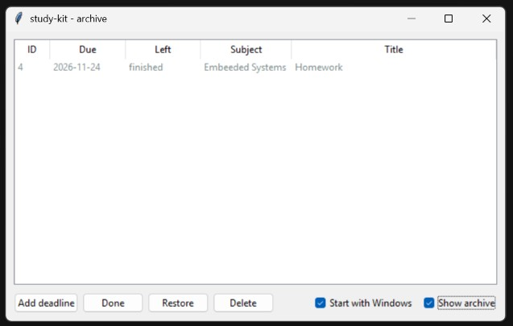
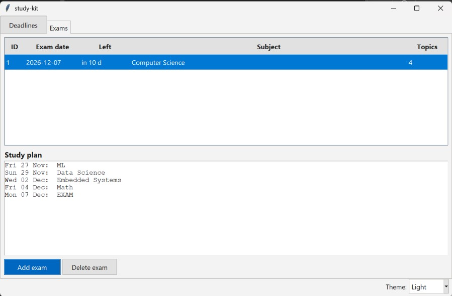

# study-kit

A small Windows app for tracking study deadlines. It opens as a simple window, so you can add subjects and deadlines with a few clicks, with no terminal needed.






[NOT UPDATED YET]

## Features

- Add deadlines with a title, a subject, and a calendar date picker
- Subjects are remembered and offered in a dropdown
- Colors show urgency: red when overdue, orange when due within 3 days
- Mark deadlines as done, then view them in the archive or restore them
- "Start with Windows" checkbox to open the app at login
- Edit any deadline by double-clicking it
- Daily Windows pop-up reminder for deadlines that are overdue, due today, or due tomorrow (can be turned off)
- New design, sharper resolution
- Exam planner
- Command-line tool too: `studykit add`, `list`, `done`, `next`

## Download (Windows)

1. Go to the [Releases page](https://github.com/Plagudoktor0/study-kit/releases) and download the latest `.zip`.
2. Unzip it and double-click `study-kit.exe`.
3. Windows may show **"Windows protected your PC"**. Click **More info**, then **Run anyway**. This happens because the app isn't code-signed. The full source code is in this repository.

Your data is stored only on your computer, in `C:\Users\<your name>\.studykit\data.json`.

**To uninstall:** untick **Start with Windows** in the app, then delete `study-kit.exe` and the `.studykit` folder.

## Run from source

Requires Python 3.10 or newer.

```
git clone https://github.com/Plagudoktor0/study-kit.git
cd study-kit
python -m venv .venv
.venv\Scripts\activate
pip install -e .
python -m studykit.gui
```

Command-line examples:

```
studykit add "OS assignment" --due 2026-12-01 --subject OS
studykit list
studykit next
studykit done 1
```

## Tests

```
pip install pytest
pytest
```

## Build the exe

```
pip install pyinstaller
pyinstaller --onefile --windowed --name study-kit --paths src --hidden-import babel.numbers --hidden-import winotify launcher.py
```
[NOT UPDATED YET]

## Roadmap

- [x] Edit a deadline by double-clicking it
- [x] Windows notifications for deadlines due tomorrow
- [x] Exam planner
- [ ] PDF toolkit (merge, split)
- [x] Dark mode

## License

MIT
